  

<h1 align="center">Opie</h1>

  <b>Every command, one flick away.</b>

  Hold a key, and a Ring of Actions opens around your pointer. 
  Flick toward one and let go. That is the whole move.

  
  

  macOS 26 or later · Apple silicon and Intel

  <a href="https://opies.io"><b>opies.io</b></a> ·
  <a href="CHANGELOG.md">Changelog</a> ·
  <a href="https://github.com/InsaneArts/opie/discussions">Discussions</a> ·
  <a href="https://github.com/InsaneArts/opie/issues/new/choose">Report a bug</a>

This repository is where Opie is discussed in public: bug reports, requests, questions, and the changelog. Opie's source code lives elsewhere and is not part of this repository.

## The move

Hold your Binding, the key that opens a Ring. The Ring opens around your pointer. Move a little toward a Slice, and let go: its Action runs. Let go in the middle, or press Escape, and nothing runs. While you hold the key, scroll to move to your next Ring, and the number keys 1 to 8 fire a Slice directly.

Each Slice sits in its own direction, so after a few days your hand knows where things are. Practice, in each Ring's settings, lets you try the move with nothing firing.

## Three kinds of Ring

**Custom Rings** are yours. Name one, give it a Binding, and fill it with up to eight Slices. It opens anywhere.

**App Rings** belong to one app each, and open only while that app is in front. All of them share one Binding, so the same key opens the right Ring for the app you are in. Opie brings ready Rings for apps such as Xcode, Safari, Chrome, Finder, VS Code, Cursor, Slack, Linear, Zoom, Things, Obsidian, OBS, Claude, and Herdr, and any app can have one. Each App Ring starts off; turn it on with its switch in Settings.

**Dedicated Rings** do one job. The Media Ring plays, pauses, and skips your music on an arc over a record that turns while it plays.

## What a Slice can run

- **An Action from the System Library.** Dark Mode, Night Shift, Keep Awake, Mute, Mission Control, Toggle Dock Auto Hide, and many more. Search finds them all.
- **An app.** Open it, or bring it to the front, with its own icon on the Slice. Running Apps opens a fan of the apps you have open.
- **A Keystroke.** Opie sends keys to the app that was in front when the Ring opened. It ships some, and you can record your own.
- **An Apple Shortcut.** Pick one from your Shortcuts and flick to run it.
- **Convert.** Convert the file selected in Finder to another format, right next to it.
- **A Group.** One Slice that holds up to eight more. Keep moving past its edge to open them.

## Make it yours

Your Custom and App Rings take your Theme and Palette, and you choose how they open, close, and sound. A Slice can carry its own tint. Your Rings and settings are plain TOML files in `~/.config/opie/`, and Opie picks up a change you make to them by hand.

## Download

Download Opie from [opies.io](https://opies.io), or take the `.dmg` of any version from the [releases page](https://github.com/InsaneArts/opie/releases). Open it and drag Opie to Applications. The `.zip` beside it is the same build in the form Sparkle installs an update in; you do not need it.

Opie lives in the menu bar and has no Dock icon until you open its Settings. To open Settings, choose Settings… in the menu bar menu, or open Opie again.

Opie updates itself with [Sparkle](https://sparkle-project.org) and checks once a day. When it finds an update, Opie appears in the Dock with a badge until you look at it. To check at once, choose Check for Updates in the menu bar menu, or Check now in Settings › General.

## Requirements

A Mac with macOS 26 or later.

**Accessibility permission.** Opie listens for the key you hold through an input tap, which macOS allows only with Accessibility. The same permission lets Opie send the keys of a Keystroke. Allow it in System Settings › Privacy & Security › Accessibility. Opie notices the change on its own.

The first time an Action needs to control another app, such as System Events for Dark Mode or the Dock, macOS asks whether Opie may. An Action that cannot run yet stays dim in the Ring and says why.

## What leaves your Mac

- **Usage events, through [TelemetryDeck](https://telemetrydeck.com).** That Opie was installed and opened, that its input started, your first Action and the first one of each day, which of Opie's own Actions ran, how each Run ended and how long it took in rough steps, and how each Ring ended: fired, cancelled, or refused. Opie adds up Runs and Ring endings and sends the totals once a minute. TelemetryDeck's SDK adds to each event a hashed random ID for this install, a session ID, the app version, the Mac model, the macOS version and processor, the screen size, the time zone, language, and region, light or dark appearance, Reduce Motion and Invert Colors, the local date and hour, and how many sessions you had and how long they were. Never the names or contents of what you make: your Rings, Keystrokes, scripts, or files. To turn it off, quit Opie, run `defaults write com.insanearts.opie OpieTelemetryEnabled -bool false`, and open Opie again.
- **Crash reports, through [Sentry](https://sentry.io), when Opie crashes.** A report holds the stack trace and details of the app, the Mac, and macOS, and no trail of what you did before the crash. To turn them off, quit Opie, run `defaults write com.insanearts.opie OpieCrashReportingEnabled -bool false`, and open Opie again.
- **The update check, once a day.** The request names Opie, its version, and Sparkle's version. It sends no profile of your Mac. To turn the daily check off, quit Opie, run `defaults write com.insanearts.opie SUEnableAutomaticChecks -bool false`, and open Opie again.

Your Rings, their Actions, and your settings stay on your Mac.

## Open source in Opie

Convert runs FFmpeg 9.0.2 and LAME 3.100, which Opie carries as separate libraries under the [GNU LGPL 2.1](https://www.gnu.org/licenses/old-licenses/lgpl-2.1.html). They are built from [ffmpeg-9.0.2.tar.xz](https://ffmpeg.org/releases/ffmpeg-9.0.2.tar.xz) and [lame-3.100.tar.gz](https://downloads.sourceforge.net/project/lame/lame/3.100/lame-3.100.tar.gz). The one change is to LAME's export list, which drops `lame_init_old`, a symbol that LAME 3.100 no longer defines. `Opie.app/Contents/Helpers/ffmpeg -buildconf` prints how FFmpeg was configured. Settings › General › Licenses shows both license texts.

## Getting help

- **Something is broken** → [open a bug report](https://github.com/InsaneArts/opie/issues/new/choose)
- **An app you want an App Ring for** → [request an App Ring](https://github.com/InsaneArts/opie/issues/new/choose)
- **Something is missing** → [open a feature request](https://github.com/InsaneArts/opie/issues/new/choose)
- **A question, or an idea to talk through** → [Discussions](https://github.com/InsaneArts/opie/discussions)
- **A security issue** → [SECURITY.md](SECURITY.md), not a public issue

[CONTRIBUTING.md](CONTRIBUTING.md) says what makes a report easy to act on.
